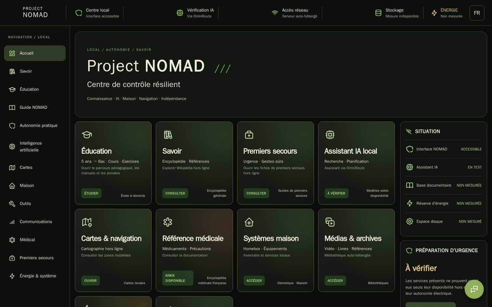
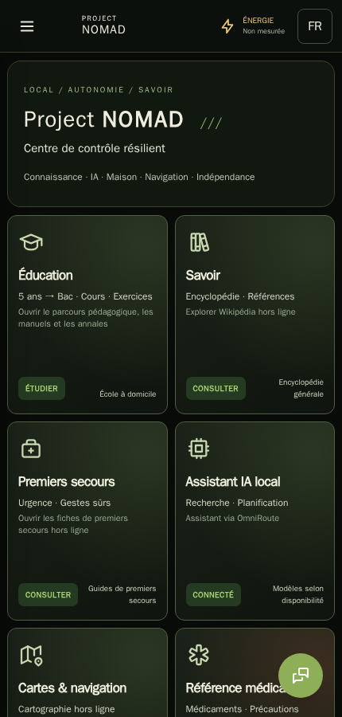
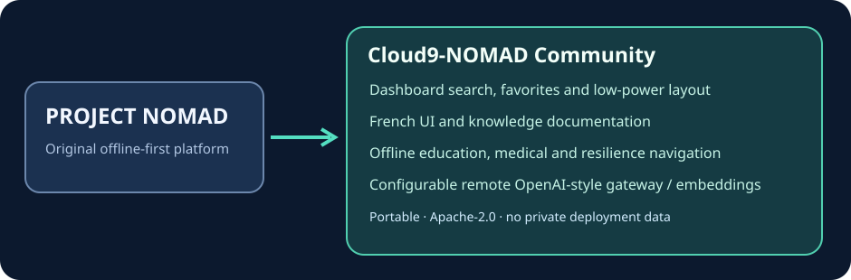

# Cloud9-NOMAD

**Une version communautaire de [Project NOMAD](https://github.com/Crosstalk-Solutions/project-nomad)**, pensée pour rester entièrement installable sur d'autres serveurs, pas seulement Cloud9.

[English](README.md) · **Français** · [简体中文](README.zh-CN.md)

## Ce que cette distribution ajoute à l'upstream

- **Accueil et navigation optimisés** : recherche dans les catégories d'applications, favoris, cartes lisibles et affichage compact/économe.
- **Interface et documentation françaises** : traduction de l'administration, du catalogue hors-ligne et des principaux guides, avec anglais toujours disponible.
- **Éducation et résilience** : accès guidé aux ressources locales installées, à la documentation médicale et aux contenus pédagogiques ; aucun site privé requis.
- **IA ouverte** : passerelle compatible OpenAI, vérification des modèles distants et embeddings configurables ; compatible avec différentes installations et non verrouillé sur une machine précise.
- **Interface graphique cohérente** : cartes de disponibilité, grands composants adaptatifs et navigation pensée pour les petits écrans.

## Langues réellement prises en charge

**Anglais / français :** sélecteur présent dans l’interface (certaines cartes d’accueil restent encore en français même si l’anglais est sélectionné). **Chinois simplifié :** documentation traduite, mais **pas encore d’interface chinoise**. Le diagramme indique explicitement cette différence. Ne pas annoncer une UI trilingue avant la traduction et les tests correspondants.

## Installation et mise à jour

Le code correspond à Project NOMAD avec des modifications communautaires et ne contient ni jeton, ni compte, ni partage de fichiers personnels. Réutiliser la procédure d'installation de l'[upstream](https://github.com/Crosstalk-Solutions/project-nomad) ; les services et URLs se configurent dans l'application. Aucun modèle ni catalogue propriétaire n'est livré.

Le code original conserve sa licence Apache-2.0 et ses auteurs. Comparaison détaillée : [fonctionnalités communautaires](docs/cloud9-community-features.md). Le projet n'est pas affilié à l'éditeur upstream.
