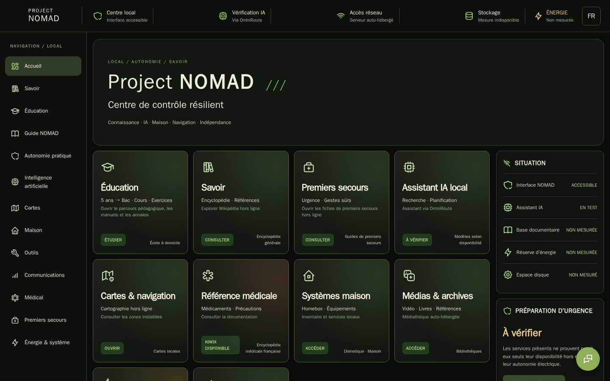
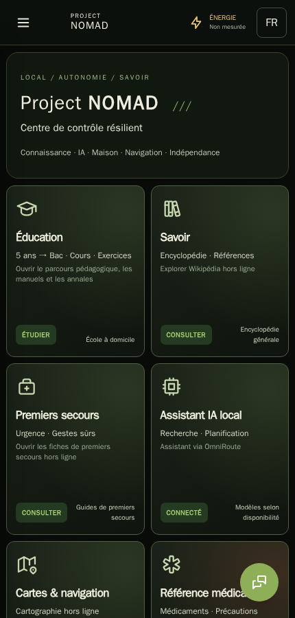
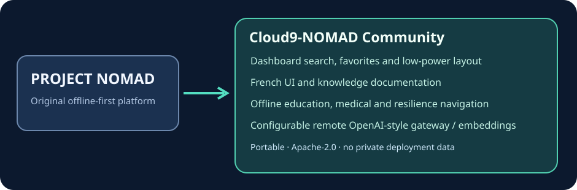

# Cloud9-NOMAD

**[Project NOMAD](https://github.com/Crosstalk-Solutions/project-nomad) 的通用社区增强版本**，可以部署在不同的自托管服务器上，不依赖个人家庭网络。

[English](README.md) · [Français](README.fr.md) · **简体中文**

## 相比上游新增的功能

- **改进的管理界面**：支持分类搜索、收藏夹、紧凑布局以及低功耗展示。
- **法语本地化**：管理界面、离线知识目录和常用文档；同时保留英语。
- **离线教育与应急知识导航**：帮助用户访问已经安装的教育、医疗和生存知识资源，不依赖任何私人域名。
- **可配置的 AI 网关**：通过兼容 OpenAI 的 API 连接远程模型与向量嵌入服务，可以使用不同的提供商。
- **更清晰的状态显示**：响应式卡片、可用性检查与小屏幕支持。

## 界面语言状态

目前支持 **英语和法语界面切换**，但部分首页卡片在英语模式下仍显示法语。**简体中文目前只有 README/文档翻译，尚未实现完整中文界面**。示意图明确说明这一点；在完成并测试 UI 翻译前，不声称支持完整的三语言界面。

## 持续维护的离线 Kiwix 资源目录

默认使用经过验证的 Cloud9-NOMAD 公共 Kiwix 资源目录，避免上游过期的归档链接。如需指定其他可信目录，可设置环境变量 `NOMAD_ZIM_CATEGORIES_URL`。CI 每周检查下载链接；不会自动下载任何 ZIM 文件。

## 安装与维护

本项目保留 [Project NOMAD](https://github.com/Crosstalk-Solutions/project-nomad) 的安装方式和 Apache-2.0 许可证。所有服务器地址与凭据均须由用户自行配置；仓库不包含个人账户、令牌或私有设备数据。

查看 [新增功能说明（英文）](docs/cloud9-community-features.md)。本项目不是原作者的官方发行版。
